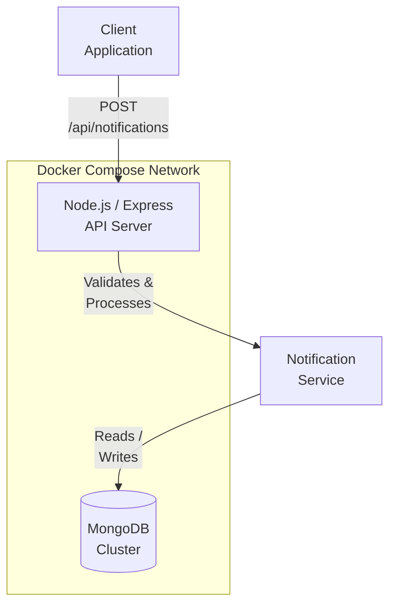
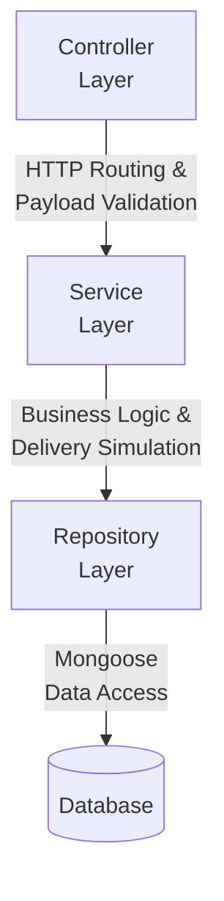

# High-Performance Notification Service API

A production-grade, highly structured, and testable backend microservice built with **Node.js**, **TypeScript**, **Express**, and **MongoDB**. Containerized with **Docker** and fully orchestrated with **Docker Compose**, this service adopts modern development practices, including strict type checking, centralized error handling, repository pattern, and extensive automated test suites using **Jest** and **Supertest** with >98% statement coverage.

--- 

## 🎥 Project Demo

[](https://youtu.be/e0o1d8mAb34)

---

## Architecture Overview & Design Choices



The project is structured following clean coding guidelines and a modular, layered architecture to isolate concerns:



```
NotifyCore/
├── src/
│   ├── config/          # Database configuration and connection helpers
│   ├── controllers/     # Express HTTP request controllers
│   ├── middlewares/     # Centralized error-handling middleware
│   ├── models/          # Mongoose database models and TypeScript interfaces
│   ├── repositories/    # Database abstraction layer (Repository pattern)
│   ├── routes/          # Express API route mapping
│   ├── services/        # Business logic and sending simulations
│   ├── utils/           # Helper functions (custom payload validation)
│   ├── app.ts           # Express application setup
│   └── server.ts        # Service entrypoint
├── tests/
│   ├── integration/     # API integration tests using Supertest
│   └── unit/            # Isolated unit tests for business logic
├── Dockerfile           # Optimized multi-stage Docker build
└── docker-compose.yml   # Multi-container service orchestration
```

### Decoupling Layers & Design Patterns
1. **Repository Pattern**: By decoupling service logic from Mongoose directly, we make database interactions highly mockable for unit testing, preventing external database dependencies in services.
2. **Centralized Error Handling**: Express middleware intercepts all async errors dynamically, standardizing response structure while avoiding exposure of database-specific stack traces or security details in production.
3. **Robust Payload Validation**: Pure TypeScript custom validation rules validate emails (RFC 5322 regex) and E.164 phone formats safely before hitting business layers, protecting against malicious database injections and invalid records.

---

## The Problem Solved & Real-World Context
In distributed architectures, multiple services (e.g., Order, User, Billing) often need to send out alerts or emails. Building dispatch logic directly into every microservice creates massive redundancy and tight coupling. **NotifyCore** extracts that responsibility into a standalone, stateless microservice. 

**Real-world Use Case:** When an e-commerce order is placed, the order service simply sends a generic REST API request to this Notification Service, which independently validates the payload, logs the intent to the database, and handles external dispatching.

---

## Challenges Overcome (DevOps)
**Container Initialization Race Conditions:** 
During Docker orchestration, the Node.js API would crash if it attempted to connect to MongoDB before the database finished initializing. 
*Solution:* Leveraged Docker Compose health checks (`test: ["CMD", "mongosh", "--eval", "db.adminCommand('ping')"]`) and explicitly configured the API service to wait using the `depends_on: service_healthy` condition. This guarantees reliable startup sequencing.

---

## Future Scope
Currently, notification dispatching is simulated synchronously within the API request lifecycle. By introducing an asynchronous message broker (like **RabbitMQ** or **BullMQ/Redis**), we can decouple ingestion from delivery entirely, achieving lower latency and supporting automated retry mechanisms.

---

## Setup & Local Development

### Prerequisites
- Node.js (v18+)
- MongoDB (running locally on port `27017` or via Docker)

### Installation
1. Clone the repository and navigate to the directory:
   ```bash
   cd NotifyCore
   ```
2. Install dependencies:
   ```bash
   npm install
   ```
3. Configure environment variables. Copy `.env.example` to `.env`:
   ```bash
   cp .env.example .env
   ```
   Modify `.env` variables if necessary:
   ```env
   PORT=3000
   MONGODB_URI=mongodb://localhost:27017/notification-db
   MOCK_EMAIL_API_KEY=your_mock_email_api_key
   MOCK_SMS_API_KEY=your_mock_sms_api_key
   ```

### Running the App
- **Development Mode** (Hot-reloads on edits):
  ```bash
   npm run dev
   ```
- **Build & Run Production Mode**:
   ```bash
   npm run build
   npm run start
   ```

---

## Running with Docker & Docker Compose

Orchestrate the entire API and its dedicated MongoDB database container using Docker.

### Docker Compose
Run a single command to spin up MongoDB (with custom health checks) and the Notification Service (waiting until MongoDB is healthy before accepting traffic):
```bash
docker-compose up --build
```
The service will be live on `http://localhost:3000`.

### Health Check Endpoint
To inspect the health status of the notification service:
```bash
curl -i http://localhost:3000/health
```

---

## API Documentation

### 📚 Interactive Swagger UI
An interactive Swagger UI is available for easy API exploration and testing.
Once the server is running, visit:
👉 **[http://localhost:3000/api-docs](http://localhost:3000/api-docs)**

---

### 1. Send Notification
- **Endpoint**: `POST /api/notifications`
- **Headers**: `Content-Type: application/json`
- **Request Payloads**:

  - **Email Notification**:
    ```json
    {
      "recipient": "test@example.com",
      "type": "email",
      "subject": "Welcome to our service!",
      "body": "Thank you for signing up."
    }
    ```
  - **SMS Notification**:
    ```json
    {
      "recipient": "+15551234567",
      "type": "sms",
      "body": "Your order has been shipped."
    }
    ```

- **Successful Response (`201 Created`)**:
  ```json
  {
    "_id": "6a32a561907cabecd0112468",
    "recipient": "test@example.com",
    "type": "email",
    "subject": "Welcome to our service!",
    "body": "Thank you for signing up.",
    "status": "sent",
    "timestamp": "2026-06-17T13:47:13.544Z"
  }
  ```

- **Validation Failed Response (`400 Bad Request`)**:
  ```json
  {
    "message": "Validation failed",
    "errors": {
      "recipient": "Recipient must be a valid email address or phone number",
      "subject": "Subject is required for email notifications"
    }
  }
  ```

---

### 2. Retrieve Notifications List (Paginated)
- **Endpoint**: `GET /api/notifications`
- **Query Parameters**:
  - `page` (optional, default: `1`): The page number.
  - `limit` (optional, default: `10`): The page size.

- **Successful Response (`200 OK`)**:
  ```json
  {
    "notifications": [
      {
        "_id": "6a32a561907cabecd0112468",
        "recipient": "test@example.com",
        "type": "email",
        "subject": "Welcome to our service!",
        "body": "Thank you for signing up.",
        "status": "sent",
        "timestamp": "2026-06-17T13:47:13.544Z"
      }
    ],
    "page": 1,
    "limit": 10,
    "totalPages": 1,
    "totalItems": 1
  }
  ```

---

## Testing & Coverage

Testing is written using Jest and Supertest.

### Run Tests
```bash
npm run test
```

### View Test Coverage
To generate the Jest coverage report:
```bash
npm run test:coverage
```

Current test suite achievements:
- **Statements**: >98%
- **Branches**: >87%
- **Functions**: 100%
- **Lines**: >98%
